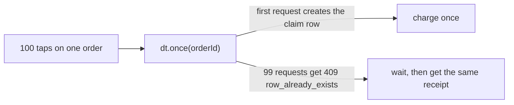
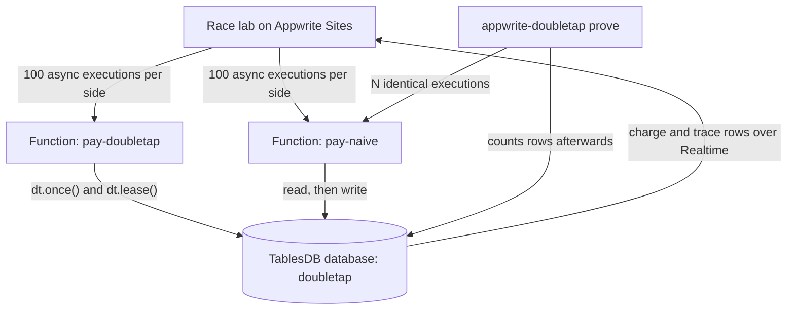

<picture>
  <source media="(prefers-color-scheme: dark)" srcset="docs/logo-light.svg" />
  
</picture>

# doubletap

doubletap makes sure something in your Appwrite app happens once, even when the same request arrives 100 times at the same moment.

It's for developers building on Appwrite who charge cards, send emails, hand out sign-up bonuses or run background jobs. Say a customer taps Pay twice on a slow connection and their phone retries. With ordinary Appwrite code, the order can get charged several times. With doubletap, it's charged once and every retry gets the same receipt back.

Live demo: https://doubletap-lab.appwrite.network · Integrate: [Add doubletap to your app](#add-doubletap-to-your-app) · Video: not available yet · Docs: this README · Submission: not linked yet


Built with: Appwrite TablesDB · Appwrite Functions · Appwrite Realtime · Appwrite Sites · TypeScript
Status: working on Appwrite Cloud (Frankfurt, Free plan). Published on npm as [appwrite-doubletap](https://www.npmjs.com/package/appwrite-doubletap) 0.2.0.

## The problem

Picture a Pay button. A customer taps it twice, their phone retries on a weak connection, or 100 people hit the same order in one second. Most backend code handles a payment in two steps:

```js
const paid = await tablesDB.listRows({ ..., queries: [Query.equal('orderId', id)] });
if (paid.total === 0) {
  await chargeCard(id);
  await tablesDB.createRow({ ... });
}
```

Under load, many requests read "not paid" before any of them writes, so each one charges. We fired 100 simultaneous taps at a normal Appwrite Function written like this. It charged 7, 17, 18 and 22 times across four runs of the prove command, and between 9 and 24 times in race lab runs.

Appwrite has no built-in idempotency for function calls or row updates. The obvious fix, a TablesDB transaction, doesn't hold either. When 100 workers raced for one expired lock inside a transaction, 2 to 5 of them won every round. That's reported upstream as [appwrite/appwrite#14489](https://github.com/appwrite/appwrite/issues/14489).

## What doubletap does

doubletap gives you four things:

1. A package with two calls. `once(key, fn)` runs a payment or job exactly once per key, and every retry gets the first result back. `lease(name)` gives one worker a job at a time and passes it to exactly one other worker if the first one dies. For Appwrite Functions, `idempotent(handler)` does the same in one line by reading the key from the request.
2. A `prove` command. Point it at your own Appwrite Function, and it fires 100 identical requests at once and counts what happened, for example "100 requests -> 22 rows in charges (expected 1). DUPLICATES FOUND".
3. A race lab, a web page that runs two races live. In the first, 100 taps hit two Pay functions side by side, and a replay draws every request as a line so you can see the ones that read "unpaid" and charged. In the second, 100 workers grab one job, once through an Appwrite transaction and once through a doubletap lease, so you can watch the transaction hand the same job to several workers.
4. An agent skill in the open [Agent Skills](https://agentskills.io) format, so any coding agent that supports skills, like Claude Code, Codex, Cursor, GitHub Copilot or Gemini CLI, learns to spot the check-then-write bug in Appwrite code and write the safe version instead.

## How it works

1. You run `doubletap prove` against your Function and see the duplicates.
2. You wrap the side effect in `dt.once(orderId, ...)`.
3. You run `prove` again and get exactly 1.



## Why Appwrite TablesDB matters

The whole guard is built on one TablesDB rule: a row ID can only be created once. Every state change creates a new row with a fixed ID such as `d3f9...-g2`. When 100 requests try to create the same ID, Appwrite lets one through and returns `409 row_already_exists` to the other 99. No Redis, no extra server and no transactions are involved.

The demo uses the rest of Appwrite too. The two Pay endpoints are Appwrite Functions, the lab's live counters come from Appwrite Realtime, and the lab itself is hosted on Appwrite Sites.

## Try it

1. Open https://doubletap-lab.appwrite.network.
2. Press Tap Pay 100 times.
3. Wait about 10 seconds. The left side shows several charges and the right side shows 1.
4. After the one-minute cooldown, press Start 100 workers. The transaction side usually shows 2 to 5 workers owning the job, and the doubletap side shows 1.

Each press runs 200 real Function executions on a Free plan project, so the lab waits a minute between races.

## Architecture



## Integration details

| Appwrite product | How doubletap uses it | Why it matters |
| --- | --- | --- |
| TablesDB | Every claim and lease is a row with a fixed ID. `createRow` on an ID that exists returns `409 row_already_exists`, so exactly one request wins. The demo also keeps `charges`, `jobs` and `trace` tables. | This is the guard itself. No Redis, lock server or transaction is involved. |
| Functions | `idempotent()` wraps a Function entrypoint. It takes the key from the `x-idempotency-key` header, scoped to `x-appwrite-user-id`, or from an event trigger's `x-appwrite-event` plus the row's `$id` and `$updatedAt`, and replays the first response to every duplicate. `pay-naive` and `pay-doubletap` are the two Pay endpoints, and `pay-doubletap` also runs `prune()` once a day on an Appwrite schedule. `prove` fires executions, with headers, at any Function you name. | The race happens inside real Appwrite Functions, the way an app would run in production, and Appwrite's own request headers and events supply the key. |
| Realtime | The lab subscribes to the `charges` and `trace` tables and updates the counters as requests finish. | You watch the race as it happens instead of reading a log afterwards. |
| Sites | The race lab is hosted at doubletap-lab.appwrite.network. | The whole demo, from page to database, runs on Appwrite. |

## What's running

Checked on 29 Oct 2026:

- Race lab: https://doubletap-lab.appwrite.network, on Appwrite Sites.
- Functions `pay-naive` and `pay-doubletap`, Node 22, Appwrite Cloud Frankfurt.
- TablesDB database `doubletap` with the tables `charges`, `jobs`, `trace` and `doubletap`.
- npm package `appwrite-doubletap` 0.2.0, installed fresh and run with `npx appwrite-doubletap prove`.
- `pay-doubletap` endpoint mode, wrapped in `idempotent()`: 100 identical requests with the same `x-idempotency-key` made 1 charge in each of 4 runs.

The project is on the Free plan, which allows two Functions. Both are used, so the lab waits a minute between races to stay inside the monthly execution limit.

## Add doubletap to your app

These steps take an existing Appwrite project from "might charge twice" to "charges once". Most apps only need steps 1, 2, 3a and 5.

### 1. Install

```bash
npm install appwrite-doubletap node-appwrite
```

The package runs on Node and uses ES modules (`import`), with node-appwrite 31 or later.

### 2. Create the doubletap table once

doubletap keeps its claims in one table inside a database you already have. Run this once, from a script or your deploy step, with a server API key that has the databases, tables and rows read and write scopes:

```ts
import { Client, TablesDB } from 'node-appwrite';
import { doubletap } from 'appwrite-doubletap';

const client = new Client()
  .setEndpoint(process.env.APPWRITE_ENDPOINT)
  .setProject(process.env.APPWRITE_PROJECT_ID)
  .setKey(process.env.APPWRITE_API_KEY);

await doubletap({ tablesDB: new TablesDB(client), databaseId: 'main' }).setup();
```

It creates a table called `doubletap` with six columns and one index. Running it again is safe. The database must already exist, and you can pass `tableId` to use another table name.

### 3. Wrap the thing that must happen once

Pick the one that matches your code.

#### 3a. A whole Appwrite Function

Wrap the Function's entrypoint:

```js
import { idempotent } from 'appwrite-doubletap';

export default idempotent(async ({ req, res, idempotencyKey }) => {
  const charge = await chargeCard(req.bodyJson.orderId, { idempotencyKey });
  return res.json(charge);
}, { databaseId: 'main' });
```

In the Function's settings, give it the `rows.read` and `rows.write` scopes. Appwrite then hands it a short-lived key, so you don't store one yourself.

Your app sends a key with each call. Use something that's the same for every retry of one action, like the order ID:

```js
await functions.createExecution({
  functionId: 'pay',
  body: JSON.stringify({ orderId }),
  headers: { 'x-idempotency-key': orderId },
});
```

The first call runs and its response carries `x-doubletap: first`. Every copy gets that same response back with `x-doubletap: replayed`, and your code doesn't run again. If a copy waits more than 20 seconds for the first call to finish, it gets a 409 with `x-doubletap: in-progress` and can retry.

Keys are scoped to the signed-in user. Callers who aren't signed in share one `guest` scope, so their keys should be random IDs and their responses shouldn't contain private data. Functions triggered by an Appwrite event, like a row being created, get a key from the event and need no header. A call with no key runs normally, without protection.

#### 3b. One step inside your own server code

```ts
const dt = doubletap({ tablesDB, databaseId: 'main' });

const { value, replayed } = await dt.once(`pay:${orderId}`, async (ctx) =>
  chargeCard(orderId, { idempotencyKey: ctx.idempotencyKey }),
);
```

The first call runs the function. Every other call with the same key gets its result back with `replayed: true`. If that call crashes, a retry takes over after `ttlMs`, which is 30 seconds by default. Pass `ctx.idempotencyKey` to your payment provider too, so a slow first call that finishes late still can't charge twice.

#### 3c. A background job only one worker should run

```ts
const lease = await dt.lease('nightly-report', { ttlMs: 60_000 });
if (lease) {
  try {
    await runReport(lease.token);
  } finally {
    await lease.release();
  }
}
```

`lease()` returns `null` when another worker holds the job. For a long job, call `lease.renew()` before `ttlMs` runs out. If it returns `false`, another worker has taken over and this one should stop. If a worker dies, exactly one other worker gets the job once the lease expires.

### 4. Clean up old rows

Finished keys stay in the table until you prune them. Run this from a scheduled Function or a cron job:

```ts
await dt.prune({ olderThanMs: 30 * 24 * 60 * 60 * 1000 });
```

It deletes finished `once()` keys older than the cutoff, which is one day by default, and keeps leases. A retry of a pruned key runs again, so pick a cutoff far longer than any retry you expect.

### 5. Prove it

Point `prove` at your Function before and after the change. It sends 100 identical calls at once and counts the rows they made:

```bash
npx appwrite-doubletap prove --function pay --count 100 \
  --body '{"orderId":"$RUN"}' --header 'x-idempotency-key=$RUN' \
  --table charges --where 'orderId=$RUN' --database main --expect 1
```

Without doubletap you'll usually see more than 1. With it you should see exactly 1. [The prove command](#the-prove-command) covers every option.

### 6. Teach your coding agent

The agent skill in [skills/doubletap/SKILL.md](skills/doubletap/SKILL.md) teaches a coding agent to spot this bug and use doubletap when it writes Appwrite code. It follows the open [Agent Skills](https://agentskills.io) format, so the same file works in any agent that supports skills.

Install it with one command from your project folder (needs Node 22.20 or later):

```bash
npx skills add CryptoZephyr/doubletap --skill doubletap
```

The [skills](https://github.com/vercel-labs/skills) installer finds the coding agents you have and puts the skill where each one looks. Add `-g` to install it for all your projects, or `-a codex -a cursor` to choose agents yourself. It supports Claude Code, Codex, Cursor, GitHub Copilot, Gemini CLI, Windsurf, OpenCode, Cline and about 70 others.

To install by hand, copy the `skills/doubletap` folder into your project:

| Agent | Folder |
| --- | --- |
| Codex, Cursor, GitHub Copilot, Gemini CLI, OpenCode, Amp, Cline and others that read the shared folder | `.agents/skills/doubletap/` |
| Claude Code | `.claude/skills/doubletap/` |
| Windsurf | `.windsurf/skills/doubletap/` |

For an agent without skill support, this prints the skill as a prompt. Paste it into the chat, or into your `AGENTS.md` or rules file:

```bash
npx skills use CryptoZephyr/doubletap@doubletap
```

### Options

`once()` takes `ttlMs` (how long a claim lives before a retry may take over, 30 seconds by default), `waitMs` (how long a copy waits for the first result, 20 seconds by default) and `pollMs`. If waiting runs past `waitMs`, it throws `DoubletapTimeoutError`. Results must be JSON and at most 8192 characters. `idempotent()` also takes `header`, `key`, `ttlMs`, `waitMs`, `tableId` and `namespace`.

## The prove command

```bash
export APPWRITE_ENDPOINT=https://fra.cloud.appwrite.io/v1
export APPWRITE_PROJECT_ID=<your project>
export APPWRITE_API_KEY=<key with functions, execution and rows scopes>

npx appwrite-doubletap prove --function pay-naive --count 100 \
  --body '{"orderId":"$RUN","requestId":"$REQ"}' \
  --table charges --where 'orderId=$RUN' --database doubletap --expect 1
```

`$RUN` becomes one ID for the whole run, and `$REQ` becomes a new ID per request. The command exits with 0 when the row count matches `--expect`, 1 when it finds duplicates, and 2 on setup or execution errors. It caps `--count` at 500.

## Evidence and failure cases

All of these ran against a real Appwrite Cloud project on the Free plan.

| Attempt | Expected | Result |
| --- | --- | --- |
| 100 taps on the plain check-then-charge Function | 1 charge | 7, 17, 18 and 22 charges (prove), 14 (a 100-execution check from a script), 9, 10 and 24 (race lab) |
| 100 taps on the doubletap Function | 1 charge | 1 charge every run |
| 100 workers take over an expired lock with a TablesDB transaction | 1 winner | 2 to 5 winners per round in scripts, 3, 5 and 4 through the deployed Function, 2 in each race lab run |
| 100 workers take over an expired lease with doubletap | 1 winner | 1 winner in 13 of 13 script rounds, 3 of 3 Function rounds and every race lab run |
| A request claims the payment, then crashes, and 100 retries follow | 1 charge, 1 receipt | 1 charge and the same receipt for all retries |
| A request stalls past its lease and wakes up late | refused | its late result is refused, but its card charge already went out (see Limitations) |

The package's own tests (`packages/doubletap/test`) cover the 100-way once race, crash recovery, stalled callbacks, callback errors, lease races, release and renewal fencing.

## Repository structure

```text
packages/doubletap   the package and the prove CLI, with live tests
apps/pay             the two demo Functions: pay-naive and pay-doubletap
apps/lab             the race lab web page, deployed to Appwrite Sites
skills/doubletap     the agent skill (SKILL.md)
```

## Run locally

```bash
npm install
npm run build -w packages/doubletap
# Live tests need APPWRITE_ENDPOINT, APPWRITE_PROJECT_ID and APPWRITE_API_KEY
npm test -w packages/doubletap
# Race lab on http://localhost:5173
npm run dev -w apps/lab
```

The demo Functions need a TablesDB database called `doubletap`. `apps/pay/setup.mjs` creates its tables and `apps/pay/deploy.mjs` deploys both Functions.

## Limitations

- A stalled request can still finish an outside call, like a card charge, after another request has taken over. The database can't undo that. Always pass `ctx.idempotencyKey` to your payment provider too.
- Expiry uses the client's clock, so servers with badly drifting clocks can shorten or stretch a lease.
- `prune()` only removes finished `once()` keys. Lease rows and crashed `pending` keys stay in the table.
- On the Free plan, Function schedules must be an interval, not a cron time, so the daily cleanup runs at a time Appwrite picks.
- In a browser, waiting on each Function call (`async: false`) makes Appwrite run the calls one after another, which hides the race. The lab sends async executions and watches the results through Realtime.
- doubletap doesn't read your source code to find races. `prove` tests a Function from the outside, and the agent skill helps coding agents avoid the pattern while they write.
- If appwrite/appwrite#14489 is fixed, the transaction row in the evidence table will stop failing. The check-then-charge result doesn't depend on that bug.

## Roadmap

- A `prove` mode for direct TablesDB writes, without a Function.

## License

MIT
