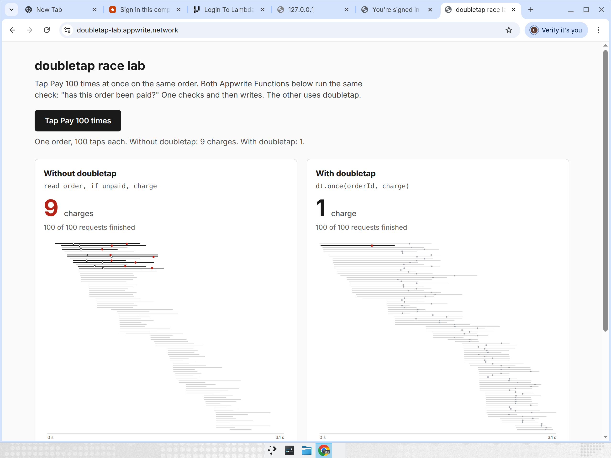
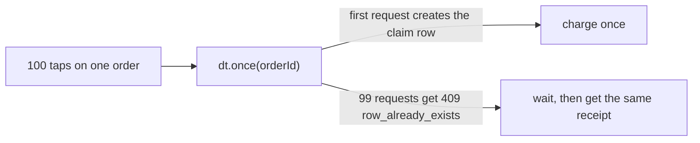

# doubletap

doubletap stops your Appwrite app from doing something twice when it should only happen once, like charging a card when someone taps Pay twice.

Live demo: https://doubletap-lab.appwrite.network · Video: not available yet · Docs: this README · Submission: not linked yet



Built with: Appwrite TablesDB · Appwrite Functions · Appwrite Realtime · Appwrite Sites · TypeScript
Status: working on Appwrite Cloud (Frankfurt, Free plan). The npm package isn't published yet.

## The problem

Picture a Pay button. A customer taps it twice, their phone retries on a weak connection, or 100 people hit the same order in one second. Most backend code handles a payment in two steps:

```js
const paid = await tablesDB.listRows({ ..., queries: [Query.equal('orderId', id)] });
if (paid.total === 0) {
  await chargeCard(id);
  await tablesDB.createRow({ ... });
}
```

Under load, many requests read "not paid" before any of them writes, so each one charges. We fired 100 simultaneous taps at a normal Appwrite Function written like this. It charged 7, 17, 18 and 22 times across four runs of the prove command, and 9 and 24 times in two runs of the race lab.

Appwrite has no built-in idempotency for function calls or row updates. The obvious fix, a TablesDB transaction, doesn't hold either. When 100 workers raced for one expired lock inside a transaction, 2 to 5 of them won every round. That's reported upstream as [appwrite/appwrite#14489](https://github.com/appwrite/appwrite/issues/14489).

## What doubletap does

doubletap gives you four things:

1. A package with two calls. `once(key, fn)` runs a payment or job exactly once per key, and every retry gets the first result back. `lease(name)` gives one worker a job at a time and passes it to exactly one other worker if the first one dies.
2. A `prove` command. Point it at your own Appwrite Function, and it fires 100 identical requests at once and counts what happened, for example "100 requests -> 22 rows in charges (expected 1). DUPLICATES FOUND".
3. A race lab, a web page that runs two races live. In the first, 100 taps hit two Pay functions side by side, and a replay draws every request as a line so you can see the ones that read "unpaid" and charged. In the second, 100 workers grab one job, once through an Appwrite transaction and once through a doubletap lease, so you can watch the transaction hand the same job to several workers.
4. An agent skill that teaches Claude Code, Codex and other coding agents to spot the check-then-write bug in Appwrite code and write the safe version instead.

## How it works

1. You run `doubletap prove` against your Function and see the duplicates.
2. You wrap the side effect in `dt.once(orderId, ...)`.
3. You run `prove` again and get exactly 1.



## Why Appwrite TablesDB matters

The whole guard is built on one TablesDB rule: a row ID can only be created once. Every state change creates a new row with a fixed ID such as `d3f9...-g2`. When 100 requests try to create the same ID, Appwrite lets one through and returns `409 row_already_exists` to the other 99. No Redis, no extra server and no transactions are involved.

The demo uses the rest of Appwrite too. The two Pay endpoints are Appwrite Functions, the lab's live counters come from Appwrite Realtime, and the lab itself is hosted on Appwrite Sites.

## Try it

1. Open https://doubletap-lab.appwrite.network.
2. Press Tap Pay 100 times.
3. Wait about 10 seconds. The left side shows several charges and the right side shows 1.
4. After the one-minute cooldown, press Start 100 workers. The transaction side usually shows 2 to 5 workers owning the job, and the doubletap side shows 1.

Each press runs 200 real Function executions on a Free plan project, so the lab waits a minute between races.

## Using the package

Install from npm:

```bash
npm install doubletap node-appwrite
```

```ts
import { Client, TablesDB } from 'node-appwrite';
import { doubletap } from 'doubletap';

const tablesDB = new TablesDB(new Client().setEndpoint(endpoint).setProject(projectId).setKey(key));
const dt = doubletap({ tablesDB, databaseId: 'main' });
await dt.setup(); // creates the doubletap table once

const { value, replayed } = await dt.once(`pay:${orderId}`, async (ctx) =>
  chargeCard(orderId, { idempotencyKey: ctx.idempotencyKey }),
);

const lease = await dt.lease('nightly-report', { ttlMs: 60_000 });
if (lease) {
  try { await runReport(lease.token); } finally { await lease.release(); }
}
```

`once()` options are `ttlMs` (how long a claim lives before a retry may take over), `waitMs` and `pollMs`. If waiting runs past `waitMs`, it throws `DoubletapTimeoutError`. Results must be JSON and at most 8192 characters.

## The prove command

```bash
export APPWRITE_ENDPOINT=https://fra.cloud.appwrite.io/v1
export APPWRITE_PROJECT_ID=<your project>
export APPWRITE_API_KEY=<key with functions, execution and rows scopes>

npx doubletap prove --function pay-naive --count 100 \
  --body '{"orderId":"$RUN","requestId":"$REQ"}' \
  --table charges --where 'orderId=$RUN' --database doubletap --expect 1
```

`$RUN` becomes one ID for the whole run, and `$REQ` becomes a new ID per request. The command exits with 0 when the row count matches `--expect`, 1 when it finds duplicates, and 2 on setup or execution errors. It caps `--count` at 500.

## Evidence

All of these ran against a real Appwrite Cloud project on the Free plan.

| Attempt | Expected | Result |
| --- | --- | --- |
| 100 taps on the plain check-then-charge Function | 1 charge | 7, 17, 18 and 22 charges (prove), 9 and 24 (race lab) |
| 100 taps on the doubletap Function | 1 charge | 1 charge every run |
| 100 workers take over an expired lock with a TablesDB transaction | 1 winner | 2 to 5 winners per round in scripts, 3, 5 and 4 through the deployed Function, 2 in the race lab |
| 100 workers take over an expired lease with doubletap | 1 winner | 1 winner in 13 of 13 script rounds, 3 of 3 Function rounds and the race lab run |
| A request claims the payment, then crashes, and 100 retries follow | 1 charge, 1 receipt | 1 charge and the same receipt for all retries |
| A request stalls past its lease and wakes up late | refused | its late result is refused, but its card charge already went out (see Limitations) |

The package's own tests (`packages/doubletap/test`) cover the 100-way once race, crash recovery, stalled callbacks, callback errors, lease races, release and renewal fencing.

## Repository structure

```text
packages/doubletap   the package and the prove CLI, with live tests
apps/pay             the two demo Functions: pay-naive and pay-doubletap
apps/lab             the race lab web page, deployed to Appwrite Sites
skills/doubletap     the agent skill (SKILL.md)
```

## Run locally

```bash
npm install
npm run build -w packages/doubletap
# Live tests need APPWRITE_ENDPOINT, APPWRITE_PROJECT_ID and APPWRITE_API_KEY
npm test -w packages/doubletap
# Race lab on http://localhost:5173
npm run dev -w apps/lab
```

The demo Functions need a TablesDB database called `doubletap`. `apps/pay/setup.mjs` creates its tables and `apps/pay/deploy.mjs` deploys both Functions.

## Limitations

- A stalled request can still finish an outside call, like a card charge, after another request has taken over. The database can't undo that. Always pass `ctx.idempotencyKey` to your payment provider too.
- Expiry uses the client's clock, so servers with badly drifting clocks can shorten or stretch a lease.
- Old state rows aren't cleaned up yet.
- In a browser, waiting on each Function call (`async: false`) makes Appwrite run the calls one after another, which hides the race. The lab sends async executions and watches the results through Realtime.
- If appwrite/appwrite#14489 is fixed, the transaction row in the evidence table will stop failing. The check-then-charge result doesn't depend on that bug.

## Roadmap

- Publish the package to npm.
- Prune old state rows.
- A `prove` mode for direct TablesDB writes, without a Function.

## License

MIT
